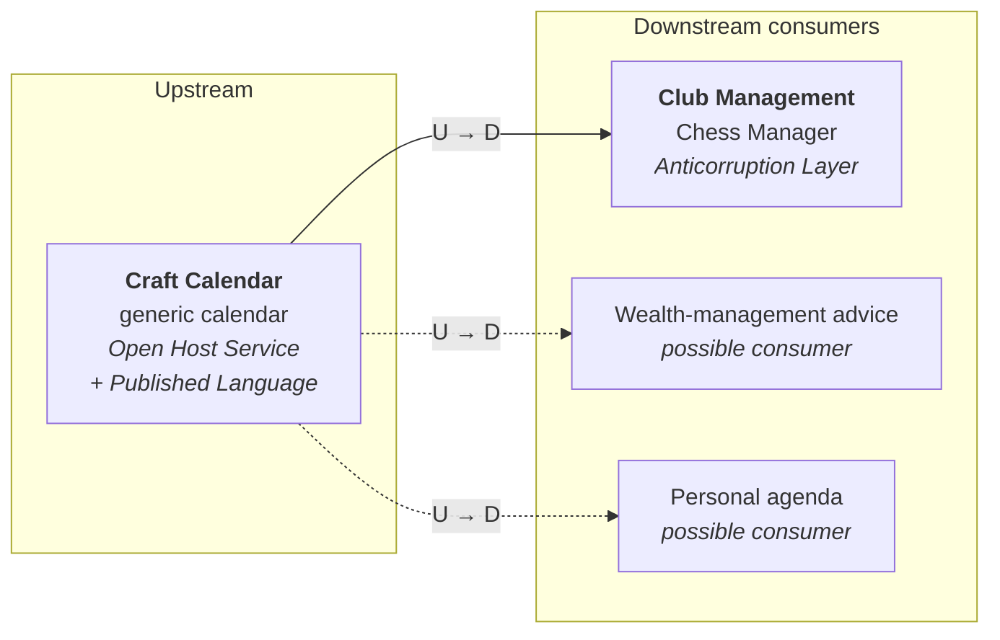
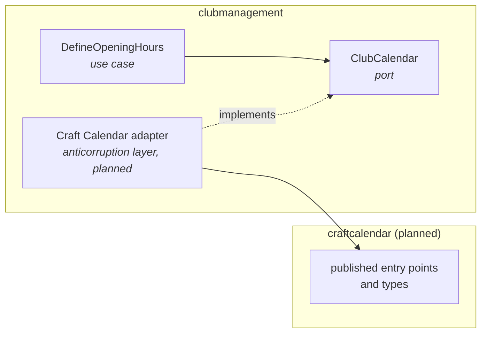

# Chess Manager

Chess Manager is a learning project built progressively with Domain-Driven Design,
Test-Driven Development and Clean / Hexagonal Architecture principles.

## Product direction: club life and competitions

Chess Manager is first a tool for the life of a chess club: its members and their licenses, its
opening hours and, since 23 October 2026, its team competitions. The first competition is the
Nationale 4 interclub championship of the Loiret: the clubs created in the application each engage
a team, a calendar fixes the matches of every round, and before a round the captain composes the
team, prints the match sheet and, afterwards, enters the results. See `docs/slices.md` for the
backlog.

Chess Decision, a personal chess-improvement tool that confronts the reasoning a player submits
about a position with the concrete resources of that position, was the product direction from
2 October 2026. It is no longer the flagship (ADR 0028): no code exists for it yet, and it is not
scheduled.

## Architecture decisions

The architecture decisions, why they were taken and what was rejected, are recorded as ADRs
(in French) in [`docs/adr`](docs/adr/README.md). This README describes how the code applies them.

## Current bounded context: Club Management

The model separates three aggregate roots:

- `Person`: personal identity (`PersonId`), names, optional email, FIDE identification and rating.
- `Club`: club identity (`ClubId`), name, and whether the application manages the club.
- `ClubRelationship`: one relationship identified by the pair `PersonId` + `ClubId`,
  its recorded status and its FFE licenses by season.

`ClubRelationship` holds identifiers, never `Person` or `Club` objects. Neither
`Person` nor `Club` contains a collection of relationships. `PROSPECT`, `MEMBER`
and `PARTNER` describe relationships, not types of people. There are no separate
bounded contexts or microservices for these aggregates.

## Proposed bounded context: Competition

Competition handles team competitions between clubs, starting with the Nationale 4 of the Loiret.
The federal rules (A02, season 2025-2026) let each league choose six boards per team instead of
eight, so the number of boards is a datum of each competition. Its language (team engaged in a
competition, match, round, board, team composition, match sheet) differs from that of Club
Management, which speaks of clubs, people and licenses. It is downstream of Club Management: an
anticorruption layer translates the members of a club (name, FFE identifier, license, rating)
into the players a captain may field, and the rules of the competition (only A licenses, a player
rated more than 100 points above a teammate plays ahead of them, the colors of each board) live in
its own domain.

**Status.** This is a proposed architectural direction (ADR 0027, awaiting validation), not
existing code yet.

## Planned bounded context: Craft Calendar

Craft Calendar is a generic calendar and scheduling bounded context. Chess Manager is its first
consumer, through the opening hours of a club, but it is meant to serve other applications
too: a wealth-management advice application, a personal agenda, and so on. It therefore never
depends on chess: it knows neither clubs, players, the FFE, tournaments nor memberships. Its
language will grow from calendars, events, recurrences, time slots and exclusion periods, and
only as far as a requested use case demands it.

**Status.** This is a validated architectural direction, not existing code yet. The slice
*Define the opening hours of a club* depends on the `ClubCalendar` port. No example asks yet for
calendar behavior (dates of occurrence, exclusions, export), so Club Management stores the
sessions itself (`JdbcClubCalendar`): Craft Calendar would only have stored the same data under
other names. It will be extracted behind the same port when an example needs real calendar
behavior; the use case and the domain will not change.

### Context map

The two contexts do not share their models. Club Management says "the club opens every Friday
from 20:00 to 22:00 for free play, at its playing venue"; Craft Calendar will say something like
"weekly recurrence, Friday, 20:00–22:00, at this address". The translation is explicit and lives
in one adapter.



- **Craft Calendar is upstream, as an Open Host Service with a Published Language.** It serves
  several consumers and bends to none of them: it publishes one protocol, in its own language.
- **Club Management is downstream, behind an Anticorruption Layer**: its `ClubCalendar` port and
  an adapter translate club concepts (sessions, activities, the playing venue of the club) into
  the published language, and back. The `Club` aggregate never depends on a Craft Calendar class
  and computes no recurrence.
- **Rejected relationships.** *Conformist*: the club model would end up speaking in recurrences.
  *Shared Kernel*: it would tie the life cycles of both contexts and forbid extracting Craft
  Calendar. *Partnership*: it assumes two teams releasing in step, which makes no sense for a
  generic context. *Separate Ways*: the need is real.
- *Customer–Supplier* describes how the work is organized (the chess needs drive the backlog of
  Craft Calendar), not how the models relate.

### Dependency direction inside the modular monolith

A bounded-context boundary is not a deployment boundary. Both contexts will live in the same
Spring Boot application and the same JVM, with no shared transaction: Club Management calls
Craft Calendar as if the call were already remote.



Only the adapter may depend on Craft Calendar, and only on what it publishes; Craft Calendar
never depends on `clubmanagement`. ArchUnit will enforce both rules once the `craftcalendar`
package exists.

### Path to a separate back-end

The boundaries are drawn so that Craft Calendar can be extracted later without rewriting the
domain of Club Management:

1. **In-process call**: the adapter calls the public Java entry points of Craft Calendar.
2. **Separate Maven module**: Club Management depends only on the published artifact, so the
   compiler guards the boundary.
3. **HTTP API**: Craft Calendar exposes its published language over HTTP, checked by a contract
   test; an HTTP adapter implements the same `ClubCalendar` port. Only the wiring changes.
4. **Separate deployment**: its own application and its own PostgreSQL database; outbound
   adapters such as Google Calendar or iCalendar belong to Craft Calendar.

Out of scope for now: excluding school holidays (Chess Manager would translate commune →
academy → zone → holiday periods into generic exclusion periods; Craft Calendar knows none of
them), and subscribing to the calendar of a club from an external agenda.

## Relationship and affiliation rules

- A person can be a prospect of several clubs before obtaining a license.
- Recording an A or B license makes the person a member of that club and affiliates
  them for the current season, including when registration happens during the season.
- A person cannot be affiliated with two clubs in the same season.
- Recording a license ends that person's other prospect relationships by default.
  An explicit request can instead preserve selected relationships as `PARTNER`.
- An affiliated person cannot be registered as a prospect of any club for that season.
- The relationship has one recorded status; it cannot be both prospect and member.
- Relationships belonging to other people are unaffected.
- Earlier seasonal affiliations are retained when a person changes club in a later
  season. Repeating the same affiliation preserves it; no new season is implicitly licensed.
- A partnership can be recorded with a club without licensing the person there and
  without changing their affiliation elsewhere.
- A person licensed for the season with a club the application does not manage is an
  external player. A club unknown to the application is, by definition, not managed.

The use cases receive the current `Season` explicitly. Calendar boundaries have not
been specified, so no calculation from today's date is implemented. The recorded
relationship status describes its last transition; current seasonal affiliation is
queried from the licenses for the requested season. Partnership termination and whether
a member may also be a partner of the same club are outside this slice. What an external
player may access once logged in belongs to a future authorization context, not to Club
Management.

### FFE identity and license renewal

These rules were stated by the club; only the first one is being implemented, by
*Register a member*. The others wait for their own slice.

- A person known as licensed by the FFE necessarily has a personal and stable FFE
  identifier, and is a member, for the season of their license, of the club in which they
  were registered. The FFE identifier comes with the first A or B license and never changes
  afterwards; a person who has never been licensed has none.
- A season starts at the start of the school year ("rentrée scolaire"), which has no fixed day.
- A license can be taken at any time during the season, as a renewal or as a new
  registration. Nothing may block it: the renewal dates below only trigger reminders and
  status changes, never a refusal.
- On 15 October, every member of the previous season who has not yet renewed their license
  with the club is reminded by email. A member who has already licensed with another club is
  not reminded: they become a partner of the club they left if they agree.
- At the end of October, the members who have still not renewed are reminded again.
- At the renewal deadline, a date the club chooses arbitrarily at the beginning of November
  (by then nearly every player has renewed), a member who has not answered is looked for in
  the other clubs, managed by the application or not:
  - licensed with another club: they become a partner of the club they left if they agree;
  - licensed nowhere: they become a prospect of the club again.
- A prospect or a partner who takes a license later in the season becomes a member again.

Modeling direction, to be confirmed by examples:

- Becoming a prospect again is a domain event of Club Management, a completed business fact
  such as `MembershipLapsed`, produced when the relationship changes from member to prospect.
- The passage of time is not a Club Management event. The reminder dates and the renewal
  deadline are dates of the season, which Craft Calendar will hold without knowing what a
  license is; it will tell that a date has been reached, in its published language. Through
  its anticorruption layer, Club Management turns that into its own decisions: find the
  members who have not renewed, remind them, let their membership lapse.
- Sending the email is not a domain event but a reaction to one, carried out by an outbound
  adapter (the future Notifications theme).
- The application learns that a player has licensed with a club it does not manage only when
  the player says so: without the FFE's written authorization, its data cannot be reused.
- A partnership with the club a player left needs the player's agreement and the approval of
  the president of that club. That approval is granted by default: the president has to
  object for the player not to become a partner. `change_club.feature`, which says a request
  alone is not enough, is to be rewritten when its slice starts.

## Application boundary and persistence

`RegisterProspect` records a new person's names and email and a prospect relationship,
or registers an existing person with another club. Internal identity generation is
supplied to the use case so tests can use deterministic IDs.

`RegisterLicense` records a license for the supplied current season and coordinates
the consequences for other prospect relationships. `ClubAffiliations` holds the
cross-club business rules (one club per season and prospect eligibility).

`RegisterPartnership` records a partnership with a club. `IsExternalPlayer` answers
whether a person is an external player for a season, from their affiliation and the
club it refers to.

The use cases depend on three ports: `PersonRepository`, `ClubRelationshipRepository`
and `ClubRepository`. The relationship repository can find a pair, list a person's
relationships, save and remove a relationship; the club repository finds and saves
clubs. These are core-owned application ports. All three have a PostgreSQL implementation (see
below), and the two newest, `PersonRepository` and `ClubRelationshipRepository`, run the same
contract tests as their in-memory fakes (`PersonRepositoryContract` and
`ClubRelationshipRepositoryContract`). For these two, only what registering a member needs is
implemented for PostgreSQL:

- `JdbcPersonRepository` stores the names, the FFE identifier, the rating and the FIDE title of a
  person; email and FIDE identifier are not stored yet, and a `Person` that carries them loses them
  silently;
- `JdbcClubRelationshipRepository` saves and finds a relationship; `findByPerson` and `delete` throw
  `UnsupportedOperationException`, because no use case wired to PostgreSQL calls them;
- `save` is a plain `INSERT`: unlike the fakes, saving the same person or relationship twice fails.

`ClubCalendar` holds the opening hours of a club, as a set of sessions. Its in-memory fake and
its PostgreSQL implementation, `JdbcClubCalendar`, run the same tests (`ClubCalendarContract`),
so the fast tests that rely on the fake can be trusted. Defining the opening hours replaces the
previous sessions: `JdbcClubCalendar` deletes and inserts them in one transaction, so that a
failure in between cannot leave a club with no or partial opening hours. No test forces that
failure; it is a design decision, not a proven behavior. The transaction belongs to the adapter,
because the use case must not depend on Spring.

`ClubRelationship` is immutable. `registerLicense` returns a new state with the same
identity; the application must save that state. The fake keys records by the two IDs.
Application tests use the same repository for setup, action and assertions and reread
persisted state. Removing `save()` was checked to make the membership test fail.

`JdbcClubRelationshipRepository` reads a relationship back by replaying its stored licenses and
status through the domain's own operations (`registerLicense`, `registerPartnership`), so that the
domain needs no constructor shaped for the database. That holds for the states the domain can
reach today; a new status or transition will have to be replayed too.

`RegisterNewMember` saves the person and then their relationship with the club: the two saves
succeed or fail together. The transaction is not in the use case, which must not depend on Spring,
nor in an adapter, since two adapters are involved: `infrastructure.TransactionalRegisterNewMember`
runs the use case in one transaction. `TransactionalRegisterNewMemberTests` forces a failure after
the first save and checks that no trace of the person remains.

`ClubMembers` is a read-only port: the members of a club for a season, as `ClubMember` read
records (names, FFE identifier, license type). It is a port of its own because the list joins a
person and their relationship with the club, which no aggregate holds. `JdbcClubMembers`
implements it with one query, sorted by last name then first name.

## Walking skeleton: create a club over HTTP

Creating a club is the first use case wired end to end, from HTTP to PostgreSQL:

```
POST /api/clubs {"name": "Montargis"}  →  201 Created, Location: /api/clubs/<id>
```

| Package | Role |
|---|---|
| `clubmanagement.createclub.rest` | `CreateClubController` translates the HTTP request into a call to `CreateClub`. |
| `clubmanagement.createclub` | `CreateClub` saves a club managed by the application and returns its `ClubId`. |
| `clubmanagement.persistence` | `JdbcClubRepository` implements `ClubRepository` with SQL through Spring's `JdbcClient`. |
| `infrastructure` | `ChessManagerApplication` starts Spring Boot; `ClubConfiguration` wires the objects explicitly. |

The domain, the ports and the use cases carry no Spring annotation; Spring objects are
declared as `@Bean`s in `infrastructure`. In production, `CreateClub` receives random UUIDs.
See [Code organization: vertical slices](#code-organization-vertical-slices) for the whole layout.

The database schema is versioned by Flyway in `src/main/resources/db/migration`
(`V1__create_club_table.sql`). Flyway applies the missing migrations, in order, when the
application starts; an applied migration is never edited, a change is a new `V<n>` file.

Authentication is deferred: nothing checks yet that the caller is an administrator.

### Run the application locally

With a running Docker engine and Java 26:

```sh
mvn spring-boot:run
```

Spring Boot starts the PostgreSQL 18 service described in `compose.yaml`, connects to it,
and Flyway migrates the schema; the application listens on port 8080. The credentials in
`compose.yaml` only protect this local container. Docker Compose support is a
development-only dependency and is skipped during tests, which use Testcontainers.

`mvn spring-boot:run` activates the `dev` profile: at each start, `DevelopmentData` empties
the tables and creates **fictitious** clubs of the Loiret committee (45) through the use cases —
eight clubs, `DEMO01` to `DEMO08`, each with ten fictitious players (FFE identifiers `DEMOJ101` to
`DEMOJ810`), so that an interclub competition between them takes seven rounds. The players are
rated from 1300 to 2400, many of them around 1800, with the same ratings at every start. The
strongest hold a FIDE title, from the FIDE rating floor of each (CM 2200, MF 2300, MI 2400). Anything created
during a session, players included, is therefore lost at the next start. Real club names, FFE
identifiers and people are personal or FFE data and must not be committed. No other profile
creates or deletes data.

```sh
curl -i -X POST localhost:8080/api/clubs -H 'Content-Type: application/json' -d '{
  "name": "Échiquier de Montargis", "committeeCode": "45", "ffeClubId": "DEMO09", "communeCode": "45208",
  "registeredOffice": {"street": "1 rue du Marché", "postcode": "45200", "town": "Montargis"},
  "playingVenue": {"street": "1 rue du Marché", "postcode": "45200", "town": "Montargis"}}'
```

## Opening hours of a club

The opening hours of a club are a set of weekly *sessions*: a day, a start time and an end time.

- A session may be for an activity, or for none. Activities form an open list: the screen
  proposes "jeu libre", "cours adultes" and "cours enfants", and a club may type others.
- A session takes place at any address; by default, at the playing venue of the club. That
  default is a reference, not a copy of the address: if the club moves its playing venue, the
  session follows it.
- Sessions may overlap, and their order does not matter.
- The administrator defines all the sessions at once: the new ones replace the previous ones.

```
GET /api/clubs/<id>/opening-hours   →  200 [{"day": "FRIDAY", "from": "20:00", "to": "22:00",
                                             "activity": "jeu libre", "venue": null}, …]
PUT /api/clubs/<id>/opening-hours   →  204 (a missing venue means the playing venue of the club)
```

## Members of a club

A member is a licensed player registered with a club for the current season.

- Registering a new member creates the person, with their personal FFE identifier (unique), and
  their membership of the club, with the type of their license, A or B. The FFE identifier comes
  with the first license and never changes.
- The FFE rating (Elo) of the player is optional: an unrated player is not a player rated zero. The
  members table shows it in an Elo column, and NC for an unrated player. A negative rating is refused.
- A FIDE title (CM, MF, MI or GMI) is an optional mention: the table shows it as a badge next to the
  name of the player, not as a column. Women's titles are not modelled.
- The members of a club are the players whose license for the current season is with that club,
  sorted by last name then first name. A player whose license dates only from a previous season is
  not listed.
- The current season is a constant, 2026-2027, in `ClubConfiguration`: the season starts at the
  start of the school year, which has no fixed day, so it is not computed from the date.

```
POST /api/clubs/<id>/members   {"firstName": "Camille", "lastName": "Martin", "ffeId": "K58213",
                                "licenseType": "A", "elo": 2310, "fideTitle": "MF"}
                                →  201 (no Location header)
GET  /api/clubs/<id>/members   →  200 [{"firstName": "Camille", "lastName": "Martin",
                                        "ffeId": "K58213", "licenseType": "A", "elo": 2310,
                                        "fideTitle": "MF"}, …]
```

`elo` is null for a player who is not rated, and `fideTitle` for a player without a title. A blank FFE
identifier, an unknown license type, a negative rating or an unknown title is refused with 400. An FFE identifier that is
already registered, or an unknown club, is refused by the database, so the answer is 500 today:
see the open questions in `docs/slices.md`. As everywhere, nothing checks yet that the caller is
an administrator.

## Competitions

*Create a competition* and *Consult the competitions of the season* are the first two slices of the
proposed Competition context (ADR 0027). So far the application creates a competition and lists the
competitions of the current season, through two screens of the front-end. A competition cannot be
opened on its own yet.

- A competition has a name, the Ligue that organizes it and a number of boards per team. Its
  season is the current season of the application (ADR 0025).
- The number of boards is strictly positive: a request with fewer than one board, or with none, is
  refused with 400 (`CompetitionNeedsAtLeastOneBoard`).
- The Ligue is designated by its name for now. Choosing it from a list will come with a slice of
  club management.
- A request without a name or without an organizing Ligue is refused with 400. An empty name or
  Ligue is not refused yet.
- The list shows the current season (ADR 0025) and, under it, the competitions of that season only,
  sorted by name then by Ligue, ignoring accents and capitals. A season without any competition is
  still shown, with an empty list. A competition has no identifier in the list yet: no screen needs
  it.
- The `competition` table has no foreign key to the club tables, and the `dev` profile empties it at
  each start.

```
POST /api/competitions   {"name": "Nationale 4", "organizingLeague": "Centre-Val de Loire",
                          "boards": 6}
                         →  201 Created, Location: /api/competitions/<id>
```

```
GET /api/competitions    →  200 {"season": {"yearBegin": 2026, "yearEnd": 2027},
                                 "competitions": [{"name": "Nationale 4",
                                                   "organizingLeague": "Centre-Val de Loire",
                                                   "boards": 6}]}
```

No endpoint serves that `Location` yet. The Pact contract records both interactions, stated by
`front-end/src/app/competition/http/http-competitions.spec.ts`: for the creation the front-end
relies on the 201 only, and treats any other answer as a failure; for the list it relies on the
season and, for each competition, its name, its organizing Ligue and its boards, after the provider
state "the competition Nationale 4 of the Centre-Val de Loire league is created for the current
season". As everywhere, nothing checks yet that the caller is an administrator.

## Front-end (Angular)

The Angular 22 application in `front-end/` is a separate npm project, not built by Maven.
It opens on the clubs managed by the application in a departmental committee: the
administrator types the number of their department and is shown each club with its commune
and its FFE identifier, sorted by name. A link leads to the French screen where the
administrator creates a club and is told whether the club has been created. Each club of the
list leads to its opening hours: the administrator sees the sessions already defined, adds or
removes sessions, and saves them all at once. Each club of the list also leads to its members: one
screen shows the members of the club, with their Elo, and registers a licensed player with their
first name, last name, FFE identifier, license type and, optionally, Elo, then tells the
administrator that they are now a member and shows them in the list. Another link, "Créer une
compétition", leads to the screen that creates a competition from its name, its organizing Ligue and
its number of boards, at `/competitions/new`: it asks for a missing name or Ligue and for a whole
number of boards of at least 1, then tells the administrator whether the competition has been
created. The link "Compétitions" leads to the competitions of the current season, at
`/competitions`: the season in the heading, then each competition with its Ligue and its number of
boards, or a notice when the season has none. It needs Node.js 22.22, 24.15 or 26 and npm.

| File | Role |
|---|---|
| `src/app/club-management/clubs-of-committee/clubs-of-committee.ts` | `ClubsOfCommittee` component: the clubs of the committee the administrator asks for. |
| `src/app/club-management/create-club/create-club.ts` | `CreateClub` component: the form and the creation outcome. |
| `src/app/club-management/create-club/commune-search.ts` | The communes matching what the administrator types. |
| `src/app/club-management/define-opening-hours/define-opening-hours.ts` | `DefineOpeningHours` component: the sessions of a club, with their activity and their venue. |
| `src/app/club-management/members-of-club/members-of-club.ts` | `MembersOfClub` component: the members of a club and the form that registers a licensed player. |
| `src/app/club-management/ports/members.ts` | `Members` port: the members of a club and the registration of a new one. |
| `src/app/club-management/http/http-members.ts` | `HttpMembers` adapter: implements `Members` over the REST API. |
| `src/app/club-management/ports/opening-hours.ts` | `OpeningHours` port: read and define the opening hours of a club. |
| `src/app/club-management/http/http-opening-hours.ts` | `HttpOpeningHours` adapter: implements `OpeningHours` over the REST API. |
| `src/app/club-management/ports/clubs.ts` | `Clubs` port: what the club screens need, with no HTTP detail. |
| `src/app/club-management/ports/communes.ts` | `Communes` port: the communes of a departmental committee. |
| `src/app/club-management/http/http-clubs.ts` | `HttpClubs` adapter: implements `Clubs` over the REST API. |
| `src/app/club-management/http/http-communes.ts` | `HttpCommunes` adapter: implements `Communes` over the REST API. |
| `src/app/competition/create-competition/create-competition.ts` | `CreateCompetition` component: the form and the creation outcome. |
| `src/app/competition/competitions-of-season/competitions-of-season.ts` | `CompetitionsOfSeason` component: the season and its competitions. |
| `src/app/competition/ports/competitions.ts` | `Competitions` port: what the competition screens need, with no HTTP detail. |
| `src/app/competition/http/http-competitions.ts` | `HttpCompetitions` adapter: implements `Competitions` over the REST API. |
| `src/app/app.routes.ts` | The clubs of a committee at `/`, the creation of a club at `/clubs/new`, the opening hours of a club at `/clubs/<id>/opening-hours`, the members of a club at `/clubs/<id>/members`, the competitions of the season at `/competitions`, the creation of a competition at `/competitions/new`. |
| `src/app/app.config.ts` | Provides the router and wires `Clubs`, `Communes`, `Competitions`, `Members` and `OpeningHours` to their HTTP adapters. |

As in the back-end, each slice has its own folder named after its use case (`create-club`);
the ports and their HTTP adapters are shared by the slices of a bounded context (`club-management`,
`competition`).

The front-end holds no business rule; they stay in the back-end.

With the back-end running (`mvn spring-boot:run`):

```sh
cd front-end
npm ci
npm start
```

Open <http://localhost:4200>. During development, `proxy.conf.json` forwards `/api`
to the back-end on port 8080, so the browser only talks to port 4200 and the back-end
needs no CORS configuration. Every REST controller is served under `/api`
(`infrastructure.WebConfiguration`), so the paths of the API never collide with the paths of the
screens: reloading `/clubs/new` shows the screen instead of calling the API.

Component tests use Vitest with jsdom (no browser); the server is simulated with
Angular's `HttpTestingController`:

```sh
npm test -- --watch=false
npm run build
```

## Contract tests between the front-end and the back-end

The front-end and the back-end are checked against a shared contract with
[Pact](https://docs.pact.io/) (consumer-driven: the front-end states what it uses).

- **Consumer side**: the specs of the HTTP adapters (`front-end/src/app/*/http/*.spec.ts`)
  run the real adapter against the Pact mock server and record each interaction in
  `front-end/pacts/chess-manager-front-chess-manager-back.json`. This file is committed.
  These specs share `front-end/src/testing/front-end-contract.ts`, so that they all write to
  the one contract the back-end verifies. Test files run one after the other
  (`vitest-base.config.mts`): run in parallel, they would overwrite each other's interactions.
- **Provider states**: an interaction can start from a business situation (`given(...)`), set up
  by the matching `@State` method of `FrontEndContractTests` through the use cases, never
  directly in the database. When the back-end generates a value the interaction needs, such as
  the identifier of a club, the `@State` method returns it and the consumer spec refers to it
  with `MatchersV3.fromProviderState`.
- **Provider side**: `contract.FrontEndContractTests` starts the back-end (with PostgreSQL in
  Testcontainers) and replays every recorded interaction against it; it runs with `mvn test`,
  without Node.

After changing an HTTP adapter or its spec, regenerate the contract from scratch (Pact merges
interactions into an existing file, so a removed interaction would otherwise linger) and commit it:

```sh
cd front-end
rm -rf pacts && npm test -- --watch=false
```

The CI regenerates the contract the same way and fails if it differs from the committed file.
Pact's anonymous usage metrics are disabled (`PACT_DO_NOT_TRACK`, `pact_do_not_track`), as is
the install-time analytics of its Scarf dependency (`scarfSettings` in `package.json`).

## Personal identity and FFE licenses

Personal equality depends on `PersonId`, not names. A person can exist without a
license or FIDE identifier. Replacing an assigned FIDE identifier is rejected;
non-positive FIDE IDs and negative ratings are rejected as before.

The FFE identifier belongs to the person, not to a license: a person receives it with
their first A or B license (`Person.licensedPlayer` for a player unknown to the
application, `takesFirstLicense` for a prospect) and keeps it for good; a person never
licensed has none. A club relationship records only the license type for each season,
and only a licensed player can be a member. Blank FFE IDs are rejected and supplied values
are preserved without an invented federation-specific format. Invalid license requests
preserve saved state. A valid license type can replace the one recorded for the same season.

Taking the license of a new season in the same club is a renewal (`renewLicenseOf`);
taking it in another club is a transfer ("mutation"), which is not a renewal.

The existing value objects remain in `clubmanagement/domain/member/vo` to limit package movement.
The former `Member` entity and `MemberId` have been replaced by `Person` and `PersonId`;
license and affiliation behavior now belongs to club relationships.

## Code organization: vertical slices

The back-end is organized by vertical slice inside the Club Management bounded context.
A slice is one use case, named after it, with its refusals and its inbound adapter:

```
clubmanagement/
  domain/                  shared model: Club, ClubRelationship, Person, value objects
  ports/                   shared ports: ClubRepository, ClubRelationshipRepository, ClubCalendar, ClubMembers (with ClubMember), Communes, PersonRepository
  createclub/              CreateClub, its refusals, rest/CreateClubController
  defineopeninghours/      DefineOpeningHours, rest/DefineOpeningHoursController
  openinghoursofclub/      OpeningHoursOfClub, rest/OpeningHoursOfClubController
  communesofcommittee/     CommunesOfCommittee, rest/CommunesOfCommitteeController
  clubsofcommittee/        ClubsOfCommittee, ClubOfCommittee, rest/ClubsOfCommitteeController
  isexternalplayer/        IsExternalPlayer
  recordperson/            RecordPerson
  registerlicense/         RegisterLicense
  registerpartnership/     RegisterPartnership
  registerprospect/        RegisterProspect
  registermember/          RegisterNewMember, rest/RegisterNewMemberController
  membersofclub/           MembersOfClub, rest/MembersOfClubController
  updateperson/            UpdatePerson
  persistence/             JdbcClubRepository, JdbcClubCalendar, JdbcPersonRepository, JdbcClubRelationshipRepository and JdbcClubMembers, shared: the clubs, their opening hours, the people, their relationships and the members
  insee/                   InseeCommunes, shared: the INSEE communes reference
infrastructure/            Spring Boot application, explicit wiring, transactions, development data
```

The domain model and the ports stay shared: an aggregate has one model, never one per
slice. Unit tests live in the package of what they test; the in-memory fakes live beside
the ports. Acceptance, architecture, contract, end-to-end and infrastructure tests are
cross-cutting. ArchUnit enforces these boundaries (see below).

## Acceptance specifications and Cucumber

Cucumber 7.22.1 runs on the JUnit Platform alongside JUnit Jupiter 6.0.3.
All Cucumber dependencies are test-scoped; the domain has no framework dependencies.

- `src/test/resources/features/implemented`: domain specifications, some without Cucumber bindings.
- `src/test/resources/features/pending`: includes the implemented relationship scenarios
  alongside future specifications; `@acceptance` determines which scenarios run.
- `RunCucumberTests`: selects scenarios tagged `@acceptance`; they form the build gate.
- `acceptance/steps`: business-language steps using a scenario driver that calls application use cases.

Scenarios speak only the business language: actors, business actions and outcomes. They never
mention HTTP, URLs, status codes, JSON, SQL, screens, buttons or frameworks; those details
belong to step definitions, drivers and adapters. A scenario must stay true whether it runs
through a use case, the REST API or the user interface (see `AGENTS.md`, section 6).

The build gate covers prospect details, rejection of a licensed prospect, rejection
of membership without a license, default rupture of other prospect links for A and B
licenses, and explicit preservation as a partner. Scenarios about partnerships and
external players are bound and pass, but are still tagged `@to_implement`, so they are
outside the gate. Visitor approval and visitor data access remain to be implemented.

A scenario is *pending* when one of its steps is undefined or throws
`PendingException`. CI runs every scenario, outside the build gate, to report pending
and failing ones (see [Continuous integration](#continuous-integration-with-github-actions)).

See [the modeling correction report](docs/club-relationship-refactoring.md) for the
initial inventory, changes and TDD evidence.

## Run the tests

The Maven project targets Java 26 and inherits its dependency management from Spring
Boot 4.1.1, which sets JUnit Jupiter to 6.0.3. Use Eclipse
Temurin 26 (an open-source OpenJDK distribution) and Maven (no Maven wrapper is
currently included). Check that `mvn -version` reports Java 26 before running.

The persistence and end-to-end tests start a real PostgreSQL 18 with Testcontainers,
so a running Docker engine is required (for example OrbStack or Docker Desktop on
macOS; `docker version` must show a Server section). Without it, these tests fail.

```sh
mvn test
```

In IntelliJ, select Temurin 26 as the Project SDK and use the Project SDK for
the Maven importer and runner, then reload the Maven project. The compiler uses
`--release 26` without preview features. Java 26 or newer is required to run the
compiled application.

To run only the affiliation tests:

```sh
mvn -Dtest=affiliation.AffiliationsTests test
```

To run the selected Cucumber scenarios:

```sh
mvn -Dtest=RunCucumberTests test
```

The full `mvn test` command runs the JUnit tests and all selected acceptance
scenarios. Cucumber writes its HTML report to
`target/cucumber/cucumber.html`.

To run every scenario, including pending ones, as CI does (Cucumber exits with a
non-zero status while some scenarios are not passing; the report is still written):

```sh
mvn test-compile org.apache.maven.plugins:maven-dependency-plugin:3.11.0:build-classpath \
  -Dmdep.outputFile=target/test-classpath.txt -Dmdep.includeScope=test
java -cp "target/test-classes:target/classes:$(cat target/test-classpath.txt)" \
  io.cucumber.core.cli.Main --glue acceptance.steps \
  --plugin html:target/cucumber-all/cucumber.html classpath:features
```

Then open `target/cucumber-all/cucumber.html` and filter on `undefined` or `pending`.

In IntelliJ, reload the Maven project after changing `pom.xml`, then run
`RunCucumberTests` to use the same scenario selection as Maven. Editor recognition
of Java step definitions requires Cucumber for Java support in addition to Gherkin.

Use RED → GREEN → REFACTOR for new behavior. Rename and simplify existing code
under green tests, keeping domain language consistent and changes small.

## Code quality with SonarQube and JaCoCo

The build includes SonarScanner for Maven 5.6.0.6792 and JaCoCo 0.8.15.
JaCoCo measures production-code coverage during both JUnit and Cucumber tests.
SonarQube imports that coverage and performs its own static analysis.

Generate the coverage reports locally, without contacting a SonarQube server:

```sh
mvn clean verify
```

- HTML coverage report: `target/site/jacoco/index.html`.
- XML coverage report imported by SonarQube: `target/site/jacoco/jacoco.xml`.
- Cucumber acceptance report: `target/cucumber/cucumber.html`.

`mvn test` runs instrumented tests; `verify` also generates the coverage reports.
Reports remain under the ignored `target` directory. No arbitrary coverage
threshold or analysis exclusion is configured.

### Connect an analysis destination

An actual Sonar analysis requires a project on SonarQube Cloud or a SonarQube
server, its project key, and an analysis token. The repository does not yet select
a destination or configure an automatic CI analysis.

Set `SONAR_HOST_URL`, `SONAR_PROJECT_KEY` and `SONAR_TOKEN` in your local environment
or CI secret settings. Use the URL of the selected server or Cloud region. Keep
the token out of Git and command-line arguments.

For SonarQube Server:

```sh
mvn clean verify sonar:sonar -Dsonar.projectKey="$SONAR_PROJECT_KEY"
```

For SonarQube Cloud, also set `SONAR_ORGANIZATION` to the organization key:

```sh
mvn clean verify sonar:sonar \
  -Dsonar.projectKey="$SONAR_PROJECT_KEY" \
  -Dsonar.organization="$SONAR_ORGANIZATION"
```

These commands send the analysis to the configured destination; a successful
local coverage build alone does not mean a Sonar analysis has run. The scanner
and coverage plugin versions are pinned in `pom.xml`.

See the official [Maven scanner documentation](https://docs.sonarsource.com/sonarqube-cloud/advanced-setup/ci-based-analysis/sonarscanner-for-maven)
and [Java coverage documentation](https://docs.sonarsource.com/sonarqube-cloud/enriching/test-coverage/java-test-coverage).

## Mutation testing with PIT

PIT 1.25.9, with its JUnit 5 plugin 1.2.3, checks whether tests detect small
changes to production bytecode. Source files are not rewritten. It mutates every
class in `clubmanagement` except the adapters (`rest`, `persistence`, `insee`) and runs
every JUnit `*Tests` class against them, excluding `acceptance` (Cucumber repeats the
use-case tests more slowly), `architecture` (ArchUnit checks dependencies, not behavior),
and the adapter and `endtoend` tests (they start PostgreSQL, too slowly to run for each
mutation).

With Maven running on Java 26:

```sh
mvn test-compile org.pitest:pitest-maven:mutationCoverage
```

PIT runs only when explicitly requested; it is not bound to `test` or `verify`.
The first run downloads the plugin and its dependencies from Maven Central.

- HTML report: `target/pit-reports/index.html`.
- XML results: `target/pit-reports/mutations.xml`.
- On macOS: `open target/pit-reports/index.html`.

Reports are ignored by Git, overwritten on the next analysis, and removed by
`mvn clean`. Rerun mutation analysis to regenerate them.

Read each mutation alongside the business rule and the test that detects it:

- `KILLED`: a test failed after the mutation.
- `SURVIVED`: the mutation was exercised but no test detected it; investigate a
  missing example or assertion, or a mutation with equivalent observable behavior.
- `NO_COVERAGE`: no selected test exercised the mutated code.
- Timeouts and execution errors need investigation; they are not passing tests.

No mutation score threshold or value-object exclusion is configured, and the
default mutation operators are used. Surviving and uncovered mutants point to
missing examples or assertions; add tests for the meaningful behavioral gaps.
PIT complements JaCoCo coverage; a perfect score is not proof that every possible
defect is detected.

See the [PIT Maven documentation](https://pitest.org/quickstart/maven/)
and the [JUnit 5 plugin](https://github.com/pitest/pitest-junit5-plugin).

## Architecture tests with ArchUnit

ArchUnit 1.4.2 runs through JUnit Jupiter as a test-only dependency.
`architecture.ArchitectureTests` holds three rules over the production classes of
`clubmanagement` (the `..` pattern includes subpackages):

- `clubmanagement.domain..` depends on no other part of the context (slices, ports,
  adapters) nor on `infrastructure..`;
- outside the adapters (`..rest..`, `clubmanagement.persistence..`,
  `clubmanagement.insee..`), no class depends on `org.springframework..`, on
  `infrastructure..` or on an adapter: the hexagon's core stays free of the framework
  and of the adapters around it;
- the slices (`clubmanagement.(*)..`) do not depend on each other; they may all depend
  on the shared `clubmanagement.domain` and `clubmanagement.ports`.

The rules import compiled production classes, excluding test classes, and check
dependencies such as field types, method signatures, annotations and calls.

Run the architecture rules with Maven on Java 26:

```sh
mvn -Dtest=architecture.ArchitectureTests test
```

It also runs automatically with `mvn test` and `mvn verify`. Results appear in
`target/surefire-reports`. Update the adapter package patterns when an adapter is added.

See the [ArchUnit user guide](https://www.archunit.org/userguide/html/000_Index.html).

## Continuous integration with GitHub Actions

The [CI workflow](.github/workflows/ci.yml) runs on pull requests, pushes to `main`
and manual dispatches. Its `Tests and mutation analysis` job uses Ubuntu 24.04,
Eclipse Temurin Java 26 and Maven, with a cache of Maven dependencies.

The job runs these steps in order:

1. The unit tests of the report script (`.github/scripts/test_ci_report.py`).
2. `mvn clean verify`: compiles and packages the project, runs JUnit (including
   ArchUnit) and the Cucumber build gate selected by `RunCucumberTests`, and creates
   the JaCoCo reports.
3. A report-only Cucumber run of every scenario, through Cucumber's command-line
   runner. Pending or failing scenarios do not fail this step; a missing report does.
4. PIT on the scope configured in `pom.xml`.
5. `.github/scripts/ci_report.py`, which writes the run summary and assembles the
   report site.

A separate `Front-end tests and build` job uses Node.js 26 with a cache of npm
dependencies. In `front-end/`, it installs the dependencies from the lockfile
(`npm ci`), runs the component tests and builds the application. A failing test or
build error fails this job.

A compilation failure, failing test, architecture violation, failing build-gate
scenario or PIT execution error fails the back-end job. As in local development, no JaCoCo or
mutation-score threshold is enforced: a surviving mutant alone does not fail the job.

Reports are available in three places:

- **Run summary**: on the run page, a table of test counts, coverage and mutation
  score, followed by the pending scenarios with links to their source lines.
- **GitHub Pages**: <https://sebmace.github.io/chess-manager/> publishes the same
  summary with the JaCoCo, PIT and Cucumber HTML reports. The Cucumber report covers
  every scenario; filter it on `undefined` or `pending`. The site is updated by the
  `Publish reports to GitHub Pages` job after each successful push to `main`, and is
  public. Pages must use **Settings → Pages → Source: GitHub Actions**.
- **Artifact**: **Actions → CI → the run → Artifacts → test-reports** contains the
  raw Surefire results and both Cucumber reports. It is uploaded even after a failure
  and retained for 14 days; reports from steps that did not complete may be absent.

The workflow requires no project secret and performs no Sonar analysis. Only the
publishing job receives the `pages: write` and `id-token: write` permissions.
Actions are pinned to commit hashes, with their release versions in comments; the
Maven dependency plugin used by step 3 is pinned by version. A newer run on the same
Git ref cancels an older in-progress run.

After the first successful GitHub run, the repository's branch rules can require
the `Tests and mutation analysis` status check before merging into `main`.
Adding this workflow does not itself enable that repository setting.

## License and authorship

MIT License. Created by Sébastien Macé.
Human contributors remain responsible for reviewing and understanding their contributions.
