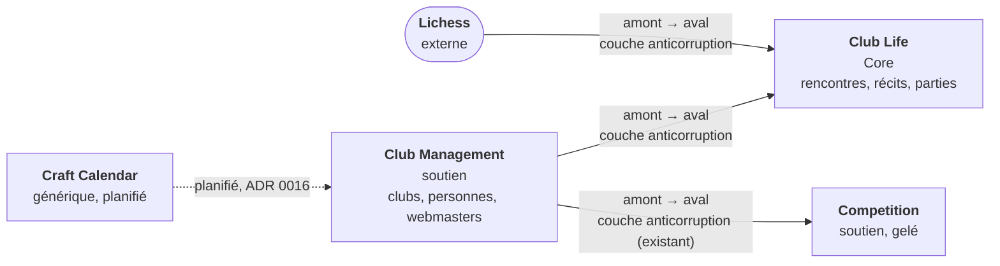

# Carte du domaine : sous-domaines, contextes et rôles

Date : 2026-11-01. Voir [l'ADR 0030](adr/0030-recentrer-sur-la-vie-des-clubs.md).

ChessManager est une plateforme indépendante pour la vie des clubs d'échecs : raconter les
rencontres, publier les comptes rendus, partager les parties commentées. Orléans est le club
pilote ; la conception reste multi-club.

## 1. Les sous-domaines (le problème)

| Sous-domaine | Type | Ce qu'il couvre | Où dans le code |
|---|---|---|---|
| Club Life | **Core** | rencontres du club, récits, actualités, activités, validation éditoriale, espace public | `clublife` (à créer) |
| Chess Experience Sharing | **Core** | parties commentées des joueurs, liées à une rencontre | `clublife` |
| Club Management | Supporting | clubs, personnes, relations avec un club, licences, horaires d'ouverture | `clubmanagement` |
| Membership | Supporting | adhésions par saison | `clubmanagement` (un sous-domaine, pas un contexte) |
| Team & Match Management | Supporting, gelé | compétitions et équipes engagées | `competition` |
| Identity & Access | Generic (authentification) ; Supporting (droits par club) | qui est connecté ; qui peut faire quoi dans quel club | droits par club : `clubmanagement` ; authentification : infrastructure |
| Calendar & Scheduling | Generic | créneaux, récurrences, rappels | Craft Calendar (planifié) |
| Saisie et analyse des parties | Generic, externe | taper les coups, commenter, analyser | Lichess |
| Affichage d'une partie | Generic | rejouer un PGN | une bibliothèque du front-end |
| FFE | hors périmètre de la V1 | | aucun |

Un sous-domaine n'est pas un contexte : Membership vit dans le contexte de la gestion de club.

## 2. Les contextes (la solution)

| Contexte | État | Rôle |
|---|---|---|
| `clubmanagement` | livré | clubs, personnes, relations, licences, horaires ; désignera le webmaster |
| `competition` | livré en partie, gelé | créer et consulter des compétitions ; engager une équipe (PR #30, ouverte) |
| `clublife` | à créer par la deuxième slice | rencontres du club, récits, contributions de parties, validation |
| `craftcalendar` | planifié, non créé | calendrier générique ([0016](adr/0016-craft-calendar-contexte-generique.md)) |

Pas de contexte pour la FFE. Pas de contexte pour les coups d'une partie.

## 3. La carte des contextes

- **Club Life est en aval de Club Management** : il apprend d'un port qu'un club existe et qui en
  est le webmaster. Seul son adaptateur dépend de `clubmanagement`, et `clubmanagement` ne dépend
  jamais de `clublife` (une règle ArchUnit, comme pour `competition`).
- **Club Life et Competition ne se connaissent pas.** Le club crée ses rencontres lui-même.
- **Lichess est en amont**, derrière un port et un adaptateur sortant : Club Life reçoit un texte
  PGN, pas un type Lichess.
- **Craft Calendar** reste autonome. Il n'est pas créé : aucune slice ne le demande.

## 4. Les rôles

Tous les droits sont relatifs à un club.

| Rôle | Peut | Ne peut pas |
|---|---|---|
| Administrateur de la plateforme | créer les clubs, nommer le webmaster d'un club | modérer le contenu (V1 : non décidé) |
| Webmaster d'un club | créer les rencontres de son club, rédiger et publier des récits, valider les contributions | agir sur un autre club |
| Joueur membre | proposer une partie d'une rencontre de son club, la commenter | publier |
| Visiteur | lire l'espace public d'un club | rien d'autre |

L'authentification reste différée ([0019](adr/0019-authentification-differee.md)) pour les deux
premières slices : la personne qui agit est une donnée du cas d'usage. Elle sera traitée avant
d'ouvrir le site aux utilisateurs d'Orléans.

## 5. Langage commun

| Terme | Sens |
|---|---|
| club | association d'échecs, déjà dans `clubmanagement` |
| rencontre | confrontation de deux clubs ou équipes, créée par le club qui la raconte (identifiant à trancher : `Match` est pris par `competition`) |
| récit | texte qui raconte une rencontre, publié au nom d'un club |
| partie | une partie jouée par un membre pendant une rencontre, conservée en PGN |
| contribution | partie (avec son commentaire) proposée par un joueur, avant validation |
| webmaster | responsable des contenus d'un club |
| espace public | les pages du club que les visiteurs lisent |

## 6. Les règles qui comptent

1. Un contenu appartient à un seul club, fixé à sa création.
2. Un webmaster n'agit que sur les contenus de son club.
3. Une contribution est proposée, puis validée ou refusée par un webmaster de son club. Seul ce qui
   est validé ou publié est public.
4. Le PGN est conservé tel que reçu, balises `SetUp`, `FEN` et `Orientation` comprises ; il ne
   dépend pas de la disponibilité de Lichess.
5. Les identifiants FFE sont des références facultatives, jamais requises.
6. Aucun fonctionnement du produit ne dépend d'un service fédéral.

## 7. Décisions sur Chess Moves et Craft Calendar

- **Chess Moves n'est pas un contexte.** Un PGN conservé en texte suffit pour raconter une partie ;
  un agrégat par coup n'a aucune justification métier. Rejouer est une brique de présentation du
  front-end ([viewer](spikes/pgn-viewer.md)), saisir et analyser est le travail de Lichess
  ([import](spikes/lichess.md)).
- **Craft Calendar reste autonome et non créé.** Il distingue le calendrier officiel d'une
  compétition, les activités internes d'un club et les capacités génériques de calendrier ; seules
  les dernières sont les siennes.
